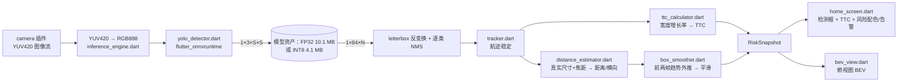

# FastGuard 移动端（Flutter · 端上推理）

**推理在手机本地完成**，不依赖 PC、不依赖网络，也不上传任何画面。
这与仓库里另一套 `mobile/`（Qt6 客户端 + PC 端推理服务）是**两种不同架构**，可按场景选用。

| 方案 | 推理位置 | 打包方式 | Windows 能否直接出包 |
|---|---|---|---|
| `mobile/`（PySide6） | 车机 / PC | `pyside6-android-deploy` | ❌ 官方仅支持 Unix 主机 |
| **`mobile_flutter/`（本目录）** | **手机本地** | `flutter build apk` | ✅ **可以**（arm64 原生支持） |

---

## 1. 架构



`pipeline/inference_engine.dart` 是 PC 端 `core/video_thread.py` 在移动端的对应物，
但**全部在设备上完成**；`core/` 下两个文件是 Python 实现的逐行移植：

| Dart | 对应 Python | 说明 |
|---|---|---|
| `core/ttc_calculator.dart` | `core/calculator.py` | 宽度增长率估 TTC、面积阈值、安全走廊、背景流过滤、静态目标识别、0/1/2 风险分级 |
| `core/ipm.dart` | `core/ipm.py` | 针孔模型 + 地平面求交，估计前方距离 |
| `core/tracker.dart` | `core/tws.py`（简化） | 端上没有 ByteTrack，改用 IoU + 质心距离的贪心关联，保证 TTC 需要的宽度历史连续 |
| `core/box_smoother.dart` | —（移动端新增） | 用前两帧运动趋势外推到第三帧的 α-β 标框平滑，仅作用于绘制（见 6.4 节） |

---

## 2. 与 PC 端的三处刻意差异

| PC 端 | 移动端 | 原因 |
|---|---|---|
| 四路画面含「预处理 / 图像增强」 | **只有 AI 推理画面** | 按需求去掉该分支（也正因此不再需要「边缘强度阈值」） |
| 阈值 = 置信度 + **边缘强度** | 阈值 = 置信度 + **TTC 告警阈值** | 边缘强度服务于预处理分支，去掉后替换为对告警更有意义的 TTC 阈值 |
| 右上角「**卸载推理**」 | 右上角「**端上推理**」 | 推理已在本机完成，不存在"卸载" |

类别过滤与 `main.py` 的 `MAIN_TARGET_CLASSES` 保持一致：**行人 / 轿车 / 卡车 / 公交车**
（设置栏可开启"显示全部 80 类"）。

---

## 3. 模型

工程里放了**同一网络的两种精度**，可在设置栏「模型精度」里切换（切换会重建会话并重置航迹）：

| | `assets/yolo11n.onnx` | `assets/yolo11n_int8.onnx` |
|---|---|---|
| 精度 | FP32（**默认**） | INT8（静态量化 QDQ） |
| 大小 | 10.1 MB | **4.1 MB** |
| 量化范围 | — | 88 个 Conv 中量化 63 个；**检测头 `/model.23/` 保持 FP32** |
| 样例图一致性 | 基线 | 留出图（zidane.jpg）与 FP32 一致到小数点后三位，框误差 1.5–5 px |
| COCO128@320 mAP50-95 | **0.3916** | 0.3627（**−7.4%**） |
| COCO128@320 召回 | **0.5045** | 0.4464（**−11.5%**） |
| x86 单帧延迟 @320 | **35.7 ms** | 52.8 ms（0.68×，即更慢） |
| x86 单帧延迟 @640 | **140.4 ms** | 151.4 ms（0.93×） |

两者规格相同，都是**动态输入**，因此切换"推理图片大小"不需要重新导出模型：

| 项 | 值 |
|---|---|
| 输入 | `images` : float32 `[1, 3, S, S]`，动态（S = 320 / 416 / 512 / 640） |
| 输出 | `output0` : float32 `[1, 84, N]`（4 框 + 80 类；N = 2100 @ S=320） |
| 预处理 | letterbox（等比例缩放 + 114/255 灰边），RGB，0–1 归一化 |
| 后处理 | 置信度过滤 → **逐类 NMS** → 反 letterbox 还原到原图 |

### 3.1 INT8 的两个坑（都实测踩过，别再踩回去）

**坑一：检测头必须保持 FP32。** 检测头输出的是**后处理前的 logits**，它的取值范围完全取决于
画面里有没有目标。用 200 帧校准图（多为远景小目标，FP32 最高置信度只有 0.25）做 MinMax 校准，
得到的激活量程很窄；一旦出现近处大目标，激活被**截断到量程上限**，表现是
**所有高置信度全部塌成 0.500**（= sigmoid(0)）：

| 模型 | bus.jpg 最高置信度 | zidane.jpg（留出图） |
|---|---|---|
| FP32 | 0.846（公交车） | 0.890 / 0.880 / 0.879 / 0.867 |
| INT8，88/88 Conv 全量化（Ultralytics 默认导出） | **0.500** ❌ | **0.500 / 0.500 / 0.500 / 0.500** ❌ |
| INT8，63/88 Conv（检测头排除，本工程采用） | 0.800 ✓ | 0.901 / 0.889 / 0.872 / 0.867 ✓ |

换成 `Entropy` 校准**不能**解决（实测仍是 0.500）——因为问题在**校准数据的量程**，不在校准算法。
往校准集里加入目标丰富的帧（如 COCO128）也能缓解（bus.jpg 恢复到 0.796），但那需要额外数据；
**排除检测头则只用仓库自带的 200 帧就够**，因此采用这个配方。

**坑二：`/model.22/` 不是检测头的名字。** YOLO11n 导出并 simplify 之后，检测头是
**`/model.23/`**（可以打印图节点名确认）。按错误的层名前缀排除只会多排除 9 个节点，
等于没排除，问题照旧。

### 3.2 重新导出与**出门检验**

```powershell
# 默认：用 assets/calibration/images 的 200 帧校准，检测头保持 FP32
python mobile_flutter\tools\export_int8_onnx.py

# 也可以把 COCO128 一起加进校准集（需要联网下载约 7 MB）
python mobile_flutter\tools\export_int8_onnx.py --extra-calib coco128

# 只做检验，不重新量化
python mobile_flutter\tools\export_int8_onnx.py --validate-only
```

脚本会写 `mobile_flutter/assets/yolo11n_int8.onnx`，并**强制**做一次 FP32 vs INT8 一致性检验
（失败返回非 0，不要发布）：置信度不得塌陷/明显偏低、**≥0.50 的检出必须逐一匹配**、检出数不得
少 20% 以上、框误差 ≤12 px。检验用的两张样例图放在 `assets/calibration/samples/`
（该目录已 gitignore；它们是第三方图片，请不要提交进仓库）：

```powershell
curl.exe -sL -o assets/calibration/samples/bus.jpg https://raw.githubusercontent.com/ultralytics/ultralytics/main/ultralytics/assets/bus.jpg
curl.exe -sL -o assets/calibration/samples/zidane.jpg https://raw.githubusercontent.com/ultralytics/ultralytics/main/ultralytics/assets/zidane.jpg
```

> 校准集里**只有 `calibration.yaml` 会进入仓库**（定义 train/val 指向 `images/`，且刻意不写
> `path:`）；`images/`、`samples/`、校验报告都已被 `.gitignore` 排除 —— 那 200 帧是实拍画面，
> 第三方样例图也不是我们的版权。Ultralytics 在缺 `path:` 键时用 YAML 所在目录作为数据集根目录，
> 而原先写死的 `G:\projectsnew\...` 在任何别的机器上都无效，会让 INT8 导出无法复现。
>
> 因此**在新克隆的仓库里导 INT8 需要自备校准帧**：把你自己的行车记录视频抽帧放进
> `assets/calibration/images/`（建议 ≥300 帧、目标类型与部署场景一致）即可，脚本会自动使用。

### 3.3 实测结论：能用，但**默认仍是 FP32**

实测环境：本机 x86（Intel Core Ultra 9 285H）+ ONNX Runtime 1.23.2 CPU；精度用 COCO128
（128 张标注图 @320），其中**校准集（本仓库 200 帧 OBS 画面）不属于 COCO128**，因此精度数字是干净的。

| 指标 | FP32 | INT8 | 结论 |
|---|---|---|---|
| 体积 | 10.1 MB | 4.1 MB | ✅ 小 2.5× |
| 样例图最高置信度 | 0.846 / 0.890 | 0.800 / 0.901 | ✅ 基本无损 |
| 框误差（样例图） | — | 1.5–5.3 px | ✅ 可用 |
| COCO128 mAP50-95 | 0.3916 | 0.3627 | ⚠️ −7.4% |
| COCO128 召回 | 0.5045 | 0.4464 | ⚠️ **−11.5%**，对安全功能不理想 |
| x86 延迟 @320 / @640 | 35.7 / 140.4 ms | 52.8 / 151.4 ms | ⚠️ 没变快（1.48× / 1.08×） |

**真机实测（MEIZU 21 Pro / Android 16 / arm64-v8a，imgsz=320，`输入=320` 一致）：**

| 模型 | 样本 | 中位 | p25 | p75 | p90 | min | max |
|---|---|---|---|---|---|---|---|
| FP32 | 25 行 | **59.1 ms** | 55.9 | 66.1 | 113.5 | 47.8 | 155.4 |
| INT8 | 14 行 | 69.5 ms | 64.9 | 77.3 | 81.3 | 48.6 | 86.9 |

真机上 INT8 **比 FP32 慢约 18%**（中位 69.5 vs 59.1 ms），与 x86 的结论方向一致。
两点说明：① INT8 的耗时分布更**稳定**（max 86.9 vs 155.4 ms，说明 FP32 那次的尖峰来自
系统抢占/温升）；② 两次采集不在同一时刻，**温漂没有被完全排除**，若要下最终结论应在同一
热状态下交替复测（重连手机后可用设置栏切换 + 「显示耗时与目标数」直接对比）。

三点必须说清楚：

1. **召回下降 11.5%** 是主要问题——对"别漏掉行人"的用途，这比框略偏更值得在意。
   对比一下：PC 端用 **OpenVINO/NNCF** 量化同样这 200 帧得到的是 mAP −3.4%、**召回零损失**。
   也就是说 **ONNX Runtime 的 QDQ 静态量化在这份校准集上不如 NNCF**。若要把 INT8 当主力，
   更该做的是**换更丰富的校准帧**（`--extra-calib coco128`，或直接用自己的行车记录视频抽帧），
   而不是继续调算法参数（已实测 `Entropy` 校准对塌陷问题无效）。
   ⚠️ 注意：若用 COCO128 做校准，就**不能**再用 COCO128 衡量精度（数据泄漏），必须另找验证集。
2. **两个平台都没有变快**：x86 上 Q/DQ 节点带来额外开销，ARM64 上同样（实测 −18%）。
   这与"INT8 一定更快"的直觉相反——只有当运行时能对整段图使用整数内核、且不频繁在
   int8/fp32 之间来回转换时才成立；本模型因为**检测头保持 FP32**，边界处有大量
   Quantize/Dequantize 转换。
3. 基于 1+2，把它做成**默认关闭的开关**而不是直接替换：FP32 已能稳定跑 ~17 FPS 等效负载
   （59 ms/帧、每 3 帧推理一次）。INT8 现在的价值是**体积小 2.5×**（省内存/省下载），
   而不是更快。

真机上怎么判：设置栏打开「显示耗时与目标数」，切换「模型精度」前后对比右上角 ms（切换会重建
会话并重置航迹，属于正常现象）。logcat 里 `[FastGuard] 模型已加载: <资产路径>` 会明确打出
**实际加载的是哪个模型**，避免"以为测了 INT8 其实还是 FP32"。

重新导出 FP32（如需换权重）：

```powershell
python -c "from ultralytics import YOLO; YOLO('assets/weights/yolo11n.pt').export(format='onnx', imgsz=320, opset=17, dynamic=True)"
# 产物 yolo11n.onnx 拷到 mobile_flutter/assets/
```

> 端上推理只能用 ONNX/TFLite 这类运行时。**PyPI 上没有 torch / ultralytics / onnxruntime
> 的 Android 轮子**（已实测核对），所以"用 Python 在手机上跑 YOLO"这条路走不通——
> 这也是本方案用 Flutter 而不是 Flet/Kivy 的原因：Flet 底层同样要 Flutter 工具链，
> 却仍无法在设备上调用这些推理库。

---

## 4. 构建 64 位 APK（Windows 上可直接完成）

### 4.1 一键装工具链（无需管理员权限）

```powershell
mobile_flutter\tools\setup_android_toolchain.bat
```

全部装在 `%LOCALAPPDATA%\FastGuardToolchain`，**不污染仓库**：

| 组件 | 用途 |
|---|---|
| `flutter\` | Flutter SDK（同时是 Flet 的必需依赖） |
| `jdk17\` | Eclipse Temurin JDK 17（Gradle 要求） |
| `android-sdk\` | platform-tools / platforms;android-35 / build-tools;35.0.0 |

结束后会生成 `%LOCALAPPDATA%\FastGuardToolchain\env.bat`，后续构建前 `call` 它即可。

### 4.2 构建

```powershell
mobile_flutter\tools\build_apk.bat
```

该脚本会：加载工具链环境 → `flutter pub get` → **`flutter test`（算法移植回归）** →
构建 **arm64-v8a** release APK。

产物：

```
mobile_flutter\build\app\outputs\flutter-apk\app-release.apk
```

安装到手机（两种方式，任选）：

```powershell
# 方式一：一键脚本（会检查设备、给出排错指引）
mobile_flutter\tools\install_apk.bat

# 方式二：直接 adb
adb install -r mobile_flutter\build\app\outputs\flutter-apk\app-release.apk
```

> 只出 **arm64-v8a**（当前几乎所有 Android 手机）。需要 64 位模拟器包时改用
> `flutter build apk --debug --target-platform android-x64`（同为 64 位 ABI）。

### 4.3 adb 说明（已随工具链装好，无需另装）

`adb` 属于 Android SDK 的 platform-tools，**`setup_android_toolchain.bat` 已经装好**：

```
%LOCALAPPDATA%\FastGuardToolchain\android-sdk\platform-tools\adb.exe   （实测 1.0.41 / 37.0.1）
```

安装脚本已把该目录**永久加入用户级 PATH**（用 .NET API 写入 `HKCU`，无需管理员，
也避免了 `setx` 的 1024 字符截断问题）。**新开一个终端**后即可直接使用 `adb`。

其它可用的调用方式：

```powershell
# 不想动 PATH：用完整路径
& "$env:LOCALAPPDATA\FastGuardToolchain\android-sdk\platform-tools\adb.exe" devices

# 或在当前终端临时加载工具链环境（flutter/jdk/adb 一起就绪）
call "%LOCALAPPDATA%\FastGuardToolchain\env.bat"
adb devices
```

撤销 PATH 修改：`设置 → 系统 → 系统信息 → 高级系统设置 → 环境变量`，
在“用户变量”的 `Path` 中删掉 `...\android-sdk\platform-tools` 即可。

**手机侧准备**（一次即可）：
1. 设置 → 关于手机 → 连点「版本号」7 次，解锁 **开发者选项**
2. 开发者选项 → 打开 **USB 调试**
3. USB 连接电脑，手机上弹出「允许 USB 调试吗？」→ 勾选“始终允许”并确定
4. `adb devices` 应看到设备号（状态为 `device`；若是 `unauthorized` 说明第 3 步未确认）

常用命令：

```powershell
adb devices                                  # 列出设备
adb install -r <apk>                         # 安装/覆盖安装
adb uninstall com.fastguard.fastguard_mobile # 卸载
adb logcat -s flutter                        # 查看应用日志（排错用）
```

无线调试（不想插线，手机与电脑需同一 Wi-Fi）：

```powershell
adb tcpip 5555                    # 先插线执行一次
adb connect 192.168.x.x:5555      # 拔线后按手机 IP 连接
```

### 4.4 本仓库已实测的构建与真机结果

在本机（Windows 11 + 免管理员工具链）实际构建通过，产物经校验：

| 项 | 实测值 |
|---|---|
| 产物 | `mobile_flutter/build/app/outputs/flutter-apk/app-release.apk`（另存一份到 `dist/FastGuard-mobile-arm64-v1.0.2.apk`） |
| 大小 | **89.8 MB**（94,156,764 字节；含 FP32 10.1 MB + INT8 4.1 MB 两个模型） |
| 包名 / 版本 | `com.fastguard.fastguard_mobile` / `1.0.2`（versionCode 3） |
| **原生 ABI** | **`arm64-v8a`（64 位）、`x86_64`（64 位）；32 位 ABI 数量 = 0** |
| minSdk / targetSdk | 24 / 36（compileSdk 36） |
| 应用名 | `FastGuard 移动端` |
| 权限 | `CAMERA`（必需）；另有插件带入的读写存储 / 网络状态权限（实际未使用）；已移除 `RECORD_AUDIO`（不录音） |
| 模型资产 | `assets/yolo11n.onnx` 10.07 MB ✓、`assets/yolo11n_int8.onnx` 4.09 MB ✓ |
| `flutter analyze` | No issues found |
| `flutter test` | 59 passed |
| SHA256 | `284c7aab12c531e4463d378936ae6e0e0b8be78611eedbfc85e1f9689b4e8f2e` |

真机验证（MEIZU 21 Pro，Android 16，页大小 4096）：

| 项 | 结果 |
|---|---|
| 安装 | `adb install -r` 成功 |
| 启动 | 正常启动，**进程持续运行无崩溃**（连续跑过 3000+ 帧） |
| 相机 | `Camera 0: Opened`（CameraX 已打开后摄） |
| 推理插件 | `FlutterOnnxRuntime.onMethodCall` 正常执行 |
| 画面 | 截图 3192×1368（**横屏**），非暗像素 27.8%，中央区域有真实场景纹理 |
| 顶栏 | 左上汉堡按钮 + 右上"端上推理"徽标（绿色"运行中"）均正常渲染 |
| 焦距读取 | `6.71mm → 23.8mm(35mm等效) → 焦距 475.6px @720px` |
| 测距输出 | `最近=行人 8.0m(横向3.2m,fused)`、`最近=轿车 2.0m(横向-0.0m,fused)`、`轿车 29.4m`、`轿车 11.7m` |
| **标框平滑** | ✅ 真机日志出现 `平滑=2/3`、`平滑=1/6`，即趋势外推确实作用到真实目标上 |
| **俯视图（BEV）** | ✅ 右下角面板渲染，画布内检出 BEV 走廊色（`0x1410B981` 合成后 ≈ (7,21,18)） |
| **INT8 模型** | ✅ 可加载并正常出检测框；真机实测**比 FP32 慢约 18%**（见 3.3 节） |
| 速度 | FP32 @320 中位 **59.1 ms**（p25 55.9 / p75 66.1）；INT8 @320 中位 69.5 ms |
| 稳定性 | 单次运行累计 4300+ 推理帧无崩溃；`adb shell pm clear` 后能干净回到默认设置 |

> 期间遇到并修复了两个"打开即闪退"的问题（插件 API 崩溃、R8 混淆裁掉 ONNX Runtime 类），
> 完整原因与修复见第 9 节。
>
> **v1.0.2（本次）与 v1.0.1 的差异**：新增**可选 INT8 量化模型**（`assets/yolo11n_int8.onnx`
> 4.1 MB + 设置栏「模型精度」开关 + `tools/export_int8_onnx.py` 导出与出门检验脚本），
> 启动时新增 `[FastGuard] 模型已加载: <资产>` 日志（否则无法从 logcat 区分实际加载了哪个模型），
> `flutter test` 由 51 条增加到 **59 条**；APK 由 86.8 MB 变为 89.8 MB（+2.99 MB，正好是
> INT8 模型压缩后的大小），ABI 与权限集完全一致。
> **默认仍是 FP32**：真机与 x86 两个平台实测 INT8 都**没有更快**（ARM64 −18%，
> 精度也有损失），见 3.3 节。
>
> **v1.0.1 与 v1.0.0 的差异**：新增「标框平滑」（`lib/core/box_smoother.dart` + `DisplaySmoother`，
> 见 6.4 节），测试由 33 条增加到 51 条；`libonnxruntime.so` / 模型资产未变。
> v1.0.0 的依赖清理（移除从未引用的 `image`、`cupertino_icons`）保留至今。
>
> 未验证项（均需你参与）：**标框平滑的真机观感**（数值与日志已确认生效，视觉平滑度需人眼判断）、
> 检测框与目标的贴合精度、距离的绝对精度（需在已知距离场景核对）、
> INT8 与 FP32 的**同热状态交替复测**（本次两次采集不在同一时刻，温漂未完全排除）。

> 已注意事项：release 版目前使用 **debug 签名**（Flutter 模板默认行为）。正式分发前需在
> `android/app/build.gradle.kts` 里配置自己的 keystore。

---

## 5. 测距原理（真实焦距 + 真实尺寸）

移动端不用 PC 端那套"猜测相机安装高度/俯仰角"的 IPM，而是读取手机相机的**真实光学参数**后
用针孔模型测距：

```
距离(米) = 真实尺寸(米) × 焦距(像素) / 目标像素尺寸
横向(米) = (u - cx) / 焦距(像素) × 距离        ← 俯视图(BEV)定位用
```

### 6.1 焦距从哪来

Flutter 的 camera 插件只给 name/lensDirection/sensorOrientation，拿不到焦距与传感器尺寸，
因此本工程自定义了一个平台通道（`fastguard/camera_info`，实现在 `MainActivity.kt`），
直接读取 Android 的 `CameraCharacteristics`：

```
cropFactor  = 43.2666 / sqrt(传感器宽² + 传感器高²)   // 全画幅对角线 43.2666mm
focal35mmEq = 物理焦距 × cropFactor
焦距(像素)   = focal35mmEq / 36mm × 图像宽度(px)        // 全画幅宽 36mm
```

用 35mm 等效焦距换算，可以避开"传感器方向 / 图像旋转"的对应问题。
**真机实测（MEIZU 21 Pro）**：

```
相机 0 · 物理焦距 6.71 mm · 传感器 9.77×7.33mm · 23.8mm(35mm等效)
测距方式 = 针孔(真实尺寸+真实焦距)，焦距(像素) = 475.6，图像宽度 = 720
```

读不到焦距时（例如权限/机型限制）自动回退到 IPM，并在设置栏"运行状态"里标明当前用的哪种。

### 6.2 真实尺寸：高度与宽度**结合**

同一个检测框可以按"真实高度 ÷ 框高"和"真实宽度 ÷ 框宽"各算一次距离。
单目测量中像素越多、相对误差越小，因此按**像素尺寸加权融合**两路结果 ——
让更可信的那一维自动占主导（例如行人身高像素远大于肩宽像素，就基本由高度决定）。

| 类别 | 高度(m) | 宽度(m) | 说明 |
|---|---|---|---|
| 行人 | 1.70 | 0.50 | 身高远比肩宽稳定 |
| 自行车（含人） | 1.10 | 0.60 | |
| **轿车** | **1.75** | 1.80 | 高度为需求给定值 |
| 摩托车（含人） | 1.10 | 0.80 | |
| **公交车** | **2.50** | 2.55 | 高度为需求给定值；宽度取道路限宽 |
| **卡车** | **3.00** | 2.55 | 高度为需求给定值；宽度取道路限宽 |

两路结果相对差 > 30% 时提示"疑似侧向视角或部分遮挡"（例如只看到车侧时，框宽≈车长会让宽度那一路偏大）。
数值集中在 `lib/core/distance_estimator.dart` 的 `objectMetrics`，按实际车型标定后统一改即可。

### 6.3 俯视图（BEV）

右下角画中画（设置栏可开关）。因为已有真实焦距，横向位置直接用
`X = (u - cx)/f × 距离` 得到，**不需要猜手机在车内的安装姿态**，只假设目标在地面附近、
手机横屏正对前方：

* 纵向网格每 5m 标注、横向每 2m；
* 中央绿色通道为行驶走廊（±1.75m）；
* 底部紫色为本车轮廓；目标按风险配色（绿/橙/红）标注距离。

### 6.4 标框平滑（用前两帧的移动趋势外推到第三帧）

端上推理给出的框每帧都会有几像素抖动，直接绘制会看到框在"跳"。这里用一个常速（α-β）滤波器：

```
速度 = (上一帧输出 - 上上帧输出) / 帧间隔      ← 前两帧的移动趋势
预测 = 上一帧输出 + 速度 × 帧间隔             ← 把框外推到当前（第三）帧
输出 = 预测 + α × (本帧测量 - 预测)          ← 平滑过渡
```

* 强度 0 → α = 1 → 输出 = 测量（等价于关闭平滑）；默认强度 0.55 → α = 0.45；
* **稳态匀速运动不引入滞后**（数学上 `α×滞后 = 0`）：单测实测 20 帧后输出与测量只差
  0.04px，而同样 α 的普通 EMA 会留下约 `(1-α)/α × 每帧位移` ≈ 12px 的稳态滞后；
* **抑制抖动**：±4px 的交替抖动被压到 ±0.7px；
* 速度用**平滑后的输出**更新（状态反馈），避免把单帧噪声放大成速度
  （直接用"测量之差"会把预测变成 `2·m₂ - m₁`，反而放大抖动）；
* 测量偏离预测超过"30% × 画面对角线"时判为**重定位**（换 ID / 误检合并），直接吸附而不滑行；
* 目标中断超过 3 帧后重新起头，与 TTC 的"时间基"处理一致。

**画面与俯视图共用一个结果**：`DisplaySmoother` 用平滑后的框**重算**距离与横向偏移，
因此两个视图的运动完全同步（不会出现"框在动、俯视图停在原地"）。

**只影响绘制**：TTC、风险分级、`minTtc` 仍使用未平滑的原始测量 —— 趋势外推值略微超前，
不适合作为风险判定输入。

---

## 6. 界面

* **满屏画面**：相机预览 + 检测框角标（类别 / TTC / 距离），按风险配色
  （绿=安全、橙=注意、红=危险），危险目标框线加粗。
* **左上角汉堡按钮**：滑入式设置栏
  * 切换摄像头（后置 / 前置）
  * 阈值设置：置信度阈值、TTC 告警阈值
  * 推理图片大小：320 / 416 / 512 / 640
  * **模型精度：FP32（默认）/ INT8**（切换会重建模型会话并重置航迹）
  * 性能：每 N 帧推理一次（低端机保流畅）
  * 显示：全部类别 / 调试信息
  * **标框平滑：开关 + 强度**（用前两帧移动趋势外推到第三帧，画面与俯视图同时生效）
  * 关于：模型规格、参数摘要、恢复默认值
* **右上角徽标**：`端上推理` + 状态（加载中 / 运行中 / 无摄像头 / 异常），
  开启调试信息后附带单帧耗时与目标数。
* 设置栏「运行状态」会显示"本帧趋势外推 N/M 个目标"，便于真机核对平滑是否生效。
* 设置持久化在 SharedPreferences，下次启动自动恢复。

### 为什么锁定横屏

`camera` 插件在竖屏下，预览会被旋转，而图像流的像素数据仍是传感器方向，
导致**检测框与画面错位 90°**。锁定横屏（`SystemChrome.setPreferredOrientations`）
可让"预览朝向 = 图像流朝向"，是行车记录场景下最省事且稳定的做法。

---

## 7. 测试

```powershell
cd mobile_flutter
flutter test
```

共 **59 条**（无需真机）：

`test/core_algorithms_test.dart`（51 条）：

* **TTC**：静止目标无风险、快速接近给出有限 TTC 与风险等级、偏离通道不告警、面积过小不放开红色告警、
  历史清理、**目标中断过久时清空历史**（避免错误的时间基）
* **跟踪器**：同一目标 ID 稳定、跨类别不错配、连续丢失后删除、IoU 计算
* **测距**：针孔公式数值校验（1.8m 宽 ÷ 90px × 焦距640px = 12.8m）、
  高低两路融合值落于两者之间、**像素越多的维度权重越大**、公交车 2.5m / 卡车 3.0m 按高度计算、
  高宽差异过大给出视角提示、过小或未标定类别返回 null、行人由高度主导
* **横向偏移**：光轴处为 0、与像素偏移和距离成正比、左右对称、参数非法返回 null
* **相机光学**：35mm 等效焦距→像素焦距换算、缺焦距时不可测距、平台通道 Map 解析
* **IPM**：下沿可测距 / 天空方向返回 null、正逆变换互逆、FOV 估焦距、俯仰角影响测距
* **引擎**：设置同步到检测器、未加载模型时返回 null 而非抛异常、resetTracking 清空状态
* **标框平滑**：首帧原样输出、第三帧严格等于"预测 + α×残差"（数值断言）、
  匀速运动无稳态滞后、±4px 抖动被压到 ±0.7px、跳变过大直接吸附、中断过久重新起头、
  同帧重复调用不外推、强度 0 等价关闭、强度/α 被限制、输出钳制在画面内且保持最小边长、
  状态清理
* **绘制平滑层**：画面标框与俯视图横向偏移**自洽**（同一个平滑框）、
  第三帧俯视图跟随趋势而不越过原始测量、未检测到的目标原样透传且不建状态、
  关闭平滑时与原始测量完全一致、缺焦距时回退 IPM 但仍按平滑框重算、
  风险字段保持原始测量结果

`test/model_assets_test.dart`（8 条）——守住"最难在真机上定位"的一类错误：代码引用了模型资产，
但**忘了在 `pubspec.yaml` 声明**或**文件根本没提交**，此时只有运行期才会失败：

* 按设置选择 FP32 / INT8 资产、两个资产都在 `pubspec.yaml` 中声明、两个资产文件真实存在且大小合理、
  INT8 确实比 FP32 小、每个资产都有界面标签
* `useInt8Model` 默认值为 FP32、`copy` 深拷贝并进入参数摘要、`copyFrom` 正确覆盖

---

## 8. 已知边界（与 PC 端一致，未做夸大）

* TTC 用检测框宽度的增长率估算，属于**启发式**方法，不构成功能安全认证；
* 测距依赖"目标类别的典型真实尺寸"：尺寸表未覆盖的类别（红绿灯、标志牌、伞、船等）
  会自动回退到 IPM，或直接不给出距离；
* 目标侧向（只看到车侧）时框宽≈车长，宽度那一路会高估距离 —— 已用"高/宽两路差异 >30%"
  给出提示，但**不能自动纠正**；
* 本车速度默认为 0（未接入车辆总线），所以 SDT 退化为 `d_safe`；
* 端上推理约 **50–70 ms/帧（≈15–18 FPS）**@imgsz 320（MEIZU 21 Pro 实测），
  低端机建议把"推理间隔"调大；
* **真机已验证**：启动、相机、ONNX 推理、测距方式与焦距读取、横向偏移计算均正常，无崩溃；
  但**距离数值的绝对精度**需要在已知距离的真实场景下逐项核对（例如把车停在 5m/10m/20m 处），
  这一步需要你参与，我无法替代。
## 9. 真机排错记录（重要：两个导致“打开即闪退”的真实原因）

在 MEIZU 21 Pro（Android 16 / SDK 36 / 页大小 4096）上安装后**打开即闪退**，通过
`adb logcat` 抓到两次不同原因的 SIGABRT，均已修复，记录如下：

### 8.1 flutter_onnxruntime 1.9.0 的 getInputInfo()/getOutputInfo() 会崩溃

```
java.lang.NoSuchMethodError: no non-static method
  "Lai/onnxruntime/NodeInfo;.<init>(Ljava/lang/String;Lai/onnxruntime/ValueInfo;)V"
Fatal signal 6 (SIGABRT)  in thread flutter-worker-
```

插件的这两个方法内部调用 ORT 的 `session.getInputInfo()`/`getOutputInfo()`，在它自己打包的
ONNX Runtime 1.28.0 上会抛 `NoSuchMethodError`，且**以原生 SIGABRT 结束进程，Dart 侧无法捕获**。

**修复**：不要调用它们。本项目所需的张量名是固定的（用 `onnx` 读取模型确认）：
输入 `images`、输出 `output0`，因此直接写常量即可（见 `lib/inference/yolo_detector.dart`）。

### 8.2 R8 混淆裁剪掉 ONNX Runtime 的类（更隐蔽）

```
JNI DETECTED ERROR IN APPLICATION: java_class == null
    in call to GetMethodID
    from boolean[] ai.onnxruntime.OrtSession.run(...)
Fatal signal 6 (SIGABRT)
```

Flutter 的 release 构建**默认开启 R8 收缩与混淆**
（`FlutterPluginUtils.shouldShrinkResources` 默认返回 true）。实测把 APK 里的
`classes.dex` dump 出来后，类名已变成 `La00;` / `Lcc0;` 这类短名，并且
`ai/onnxruntime` 下**只剩 3 个类**（`NodeInfo`/`OnnxModelMetadata`/`OnnxRuntime`）——
`OrtSession`、`OnnxTensor`、`ValueInfo`、`OnnxValue` 等全被裁剪。

而 ONNX Runtime 的原生库（`libonnxruntime4j_jni.so`）是按**原始类名/方法名**做 JNI 查找的
（`FindClass` / `GetMethodID`），类被改名或删掉就返回 null，直接 SIGABRT。

**修复**：在 `android/app/proguard-rules.pro` 中添加保留规则，并在 release 构建类型里挂上它：

```proguard
-keep class ai.onnxruntime.** { *; }
-keep class com.masicai.flutteronnxruntime.** { *; }
-keepclasseswithmembernames class * { native <methods>; }
```

```kotlin
// android/app/build.gradle.kts
release {
    isMinifyEnabled = true
    isShrinkResources = true
    proguardFiles(getDefaultProguardFile("proguard-android-optimize.txt"), "proguard-rules.pro")
}
```

修复后 `ai/onnxruntime` 的关键类全部保留（`classes.dex` 由 2.0 MB 变为 2.6 MB），
APK 由 86.6 MB 变为 86.9 MB，应用在真机上正常启动并持续运行。

> 若日后接入更多依赖 JNI/反射的插件（如其它原生推理库），遇到 `java_class == null`
> 这类 JNI 报错，优先检查是否有类被 R8 混淆，而不是去怀疑版本不兼容。

### 9.3 真机调试笔记（本次实测踩到的坑）

1. **`adb exec-out screencap -p > 文件` 不能用 PowerShell 的 `>`**：PowerShell 会把二进制
   当文本重写，截出来的 PNG 无法打开（报"内存不足"）。要用 `cmd /c "adb ... > file"`，
   或者用 Python `subprocess` 拿 `bytes`。
2. **重置到默认设置用 `adb shell pm clear com.fastguard.fastguard_mobile`**：比在界面上逐个
   改回来可靠（改完记得重新 `pm grant ... CAMERA`）。release 包不可调试，不能用 `run-as`
   去改 SharedPreferences。
3. **`adb shell input tap/swipe` 的合成手势会误触**：实测长时间连续滑动后，
   「推理图片大小」被改成了 640px——即某次滑动被判成了点击。**测延迟前务必先确认
   `input=` 字段是否一致**，否则会拿 FP32@640 和 INT8@320 做对比，结论全错。
   本次就是靠日志里的 `input=` 才发现这个偏差。
4. **抽屉的 z 序**：`_HomeScreenState` 的 Stack 顺序是
   `preview → 检测框 → BEV → 遮罩(scrim) → 顶栏 → 抽屉`。遮罩覆盖整屏且 `onTap` 关闭抽屉，
   而顶栏的 `Container` 只画渐变、不拦截指针事件，所以**点顶栏空白处或右上徽标也会关掉抽屉**
   （只有汉堡按钮自己是 Material/InkWell 会拦截）。这对用户是"点外部关闭"的正常行为，
   但做 UI 自动化时要知道点击要落在抽屉内（x < 420 逻辑 px）。
5. **本机（MEIZU 21 Pro）的 devicePixelRatio = 3.5**（物理 3192×1368 ↔ 逻辑 912×391），
   抽屉宽度正好是 `clamp(300,420)` 取到的 **420 逻辑 px = 1470 物理 px**。做坐标换算时可直接用。

## 10. 构建踩过的坑（构建期）
1. **NDK 被无谓下载约 1 GB 且下载损坏导致构建失败**：Flutter 模板默认
   `ndkVersion = flutter.ndkVersion`，即使项目没有 C/C++ 代码也会触发 NDK 下载。
   本项目所有插件的 Android 端都是 Kotlin（`flutter_onnxruntime` 的 ONNX Runtime
   来自 Maven 预编译 AAR），因此已注释掉该行。
2. **Windows 下 Kotlin 增量编译缓存报 `Could not close incremental caches`**：
   在 `android/gradle.properties` 中关闭增量编译
   （`kotlin.incremental=false`、`kotlin.compiler.execution.strategy=in-process`）。
3. 另注：`defaultConfig.ndk.abiFilters` **不会**过滤预编译 AAR 里的 jniLibs，
   32 位的 `armeabi-v7a` 仍会被打进包（实测 +20 MB）；必须在
   `packaging { jniLibs { excludes += ... } }` 中再排除一次，才能得到纯 64 位产物。

---

## 11. 目录结构

```
mobile_flutter/
├── pubspec.yaml                     # 依赖：flutter_onnxruntime / camera / shared_preferences
├── analysis_options.yaml
├── assets/
│   ├── yolo11n.onnx                 # 10.1 MB，FP32，输入 1x3xSxS（动态）
│   └── yolo11n_int8.onnx            # 4.1 MB，INT8(QDQ)，检测头保持 FP32
├── android/
│   ├── app/build.gradle.kts         # 关闭 ndkVersion、只留 64 位 ABI、挂 R8 保留规则
│   └── app/proguard-rules.pro       # 保留 ai.onnxruntime.**（否则真机闪退，见第 8 节）
├── lib/
│   ├── main.dart                    # 入口（锁横屏 + 沉浸式）
│   ├── settings.dart                # 设置持久化（SharedPreferences）
│   ├── core/
│   │   ├── ttc_calculator.dart      # ← core/calculator.py 移植
│   │   ├── ipm.dart                 # ← core/ipm.py 移植（仅作测距回退）
│   │   ├── distance_estimator.dart  # 针孔测距：真实尺寸(高/宽融合) × 真实焦距
│   │   ├── box_smoother.dart        # 标框平滑：前两帧趋势外推到第三帧（α-β 滤波）
│   │   ├── camera_optics.dart       # 读取设备真实焦距/传感器（平台通道封装）
│   │   └── tracker.dart             # 端上航迹稳定器
│   ├── inference/
│   │   ├── model_assets.dart        # FP32 / INT8 资产清单与切换（含配方说明）
│   │   └── yolo_detector.dart       # ONNX 推理 + letterbox + NMS（支持切换模型）
│   ├── pipeline/
│   │   └── inference_engine.dart    # 端上管线（含 DisplaySmoother 绘制平滑层）+ YUV420→RGB
│   └── ui/
│       ├── home_screen.dart         # 满屏画面 + 汉堡按钮 + 徽标 + 模型切换
│       ├── bev_view.dart            # 右下角俯视图（BEV）
│       └── settings_drawer.dart     # 设置栏
├── test/
│   ├── core_algorithms_test.dart    # 算法回归测试（51 条）
│   └── model_assets_test.dart       # 模型资产/依赖声明回归测试（8 条）
└── tools/
    ├── setup_android_toolchain.bat  # 一键装 Flutter/JDK/Android SDK（免管理员）
    ├── build_apk.bat                # 一键出 arm64 APK
    ├── install_apk.bat              # 一键安装到已连接的手机（含排错指引）
    └── export_int8_onnx.py          # 导出 INT8 ONNX 并强制做一致性检验（见 3.2 节）
```
